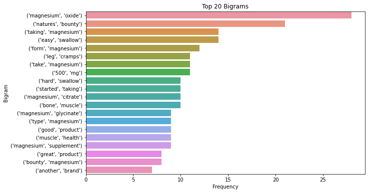
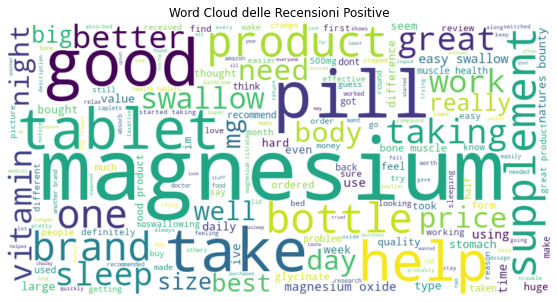

# Sentiment analysis di recensioni Amazon

Analisi del sentiment e text mining sulle recensioni Amazon in lingua inglese di un integratore di magnesio. Il progetto mette a confronto tre approcci di classificazione del sentiment (**VADER**, **TextBlob** e **BERT**) ed esplora i temi più ricorrenti nelle recensioni.

Progetto del corso di Text Mining — Laurea Triennale in Tecniche Informatiche per la Gestione dei Dati, Università LUMSA (giugno 2024).

**Tecnologie:** Python · pandas · NLTK · TextBlob · Hugging Face Transformers (BERT) · scikit-learn · gensim · WordCloud · matplotlib · seaborn · Plotly

---

## Dati

- **418 recensioni** (dopo la pulizia) raccolte da Amazon, con nome utente, data, stelle, titolo e testo.
- Amazon mostra solo 100 recensioni per volta, quindi le recensioni sono state raccolte filtrando per numero di stelle. Il risultato è un dataset **bilanciato** tra 1 e 5 stelle: non rispecchia la distribuzione reale delle recensioni, ma consente di confrontare bene le classi.
- Il dataset originale non è più disponibile e quindi non è incluso. Il notebook mantiene tutti gli output dell'esecuzione originale.

## Cosa fa il notebook

1. **Pulizia:** rimozione di duplicati, valori mancanti e colonne inutili; conversione delle date e delle stelle in formato numerico.
2. **Pre-elaborazione del testo:** minuscole, rimozione della punteggiatura, tokenizzazione, rimozione delle stopwords, lemmatizzazione (NLTK).
3. **Rappresentazione:** matrice TF-IDF (418 recensioni × 2.031 termini).
4. **Sentiment analysis:** classificazione positiva / negativa / neutra con VADER, TextBlob e BERT (`distilbert-base-uncased-finetuned-sst-2-english`), confrontati su accuracy, precision, recall e F1-score.
5. **Analisi esplorativa:** word cloud per classe di sentiment, distribuzione del sentiment, sentiment per numero di stelle, lunghezza delle recensioni, top 20 bigrammi, topic modelling.

## Risultati

Tra gli strumenti confrontati, **VADER** è stato scelto per l'analisi finale.

**Nota metodologica:** le etichette di riferimento usate per il confronto sono state generate con VADER stesso. Per questo VADER ottiene punteggio 1,0, e le metriche di TextBlob (accuracy 0,74) e BERT (0,46) misurano quanto concordano con VADER, non l'accuratezza rispetto a un'etichetta reale. Il modello BERT usato, inoltre, classifica solo in positivo/negativo e ha lavorato sul testo già lemmatizzato: due fattori che ne abbassano il punteggio.



I bigrammi più frequenti riguardano il tipo di magnesio (*magnesium oxide*, *magnesium citrate*, *magnesium glycinate*), la facilità di deglutizione delle compresse (*easy swallow*, *hard swallow*) e gli effetti percepiti (*leg cramps*, *muscle health*).



## Possibili miglioramenti

- Usare le **stelle come etichetta di riferimento** (1–2 negativo, 3 neutro, 4–5 positivo), per un confronto più oggettivo tra i modelli.
- Passare a BERT il **testo originale**, non pre-elaborato, e usare un modello a tre classi (ad esempio `cardiffnlp/twitter-roberta-base-sentiment-latest`).
- Addestrare un classificatore supervisionato (regressione logistica o SVM) sulla matrice TF-IDF.

## Come eseguirlo

```bash
pip install -r requirements.txt
python -m nltk.downloader punkt stopwords wordnet vader_lexicon
jupyter notebook sentiment_analysis_recensioni.ipynb
```

Per rieseguirlo serve un CSV di recensioni con le colonne `username`, `date`, `stars`, `review title` e `Review text`, da mettere nella cartella `data/`.

---

Autrice: **Federica Leacche**
